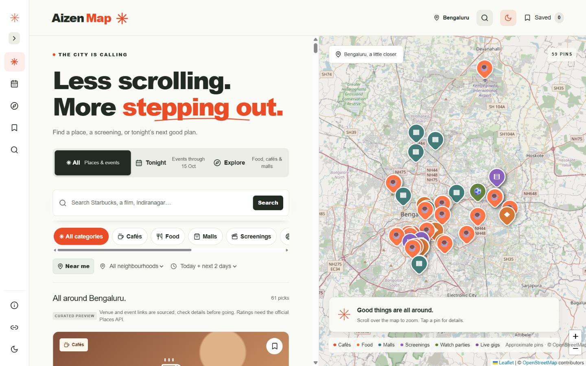
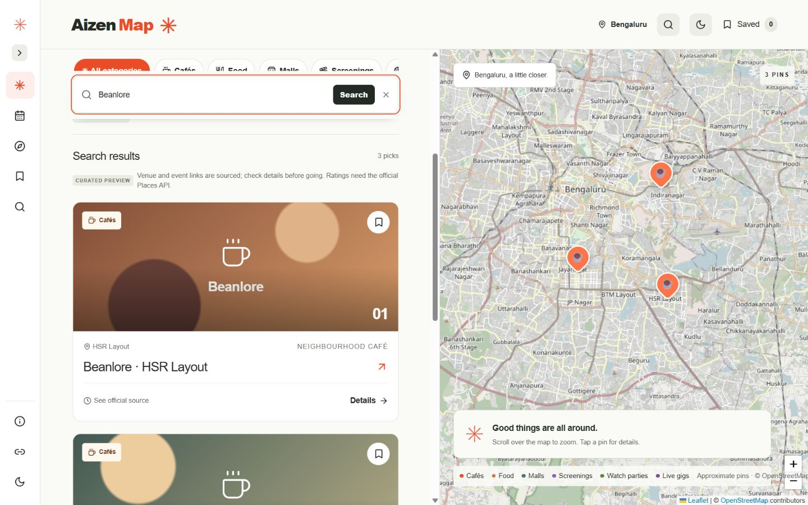
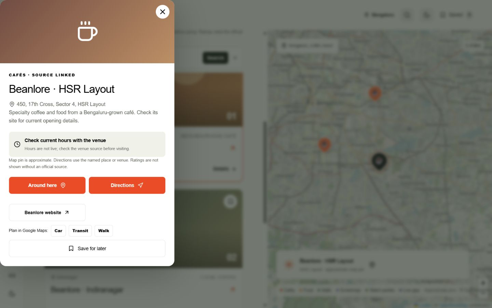
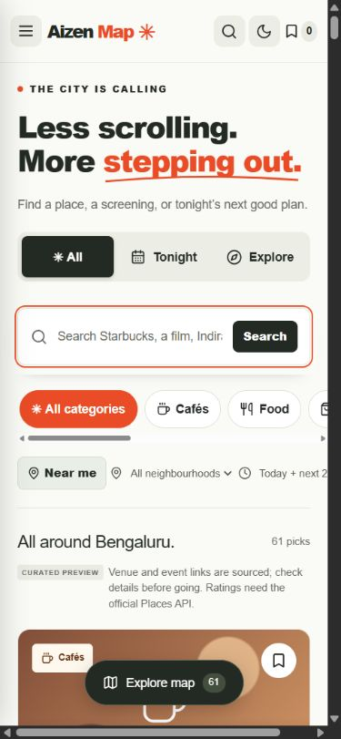
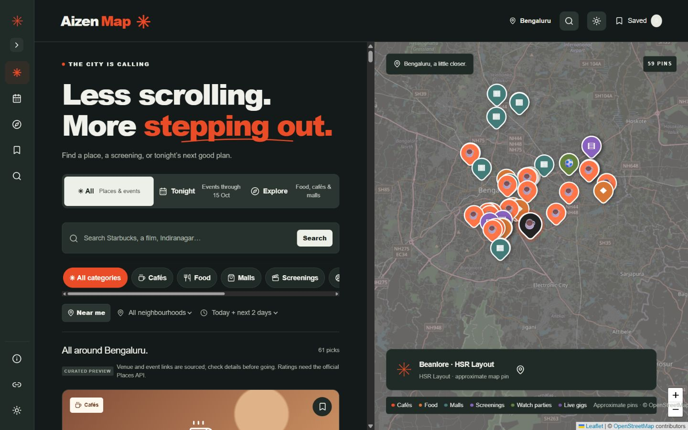

# Aizen Map

Aizen Map is a responsive Bengaluru discovery website that pairs a curated list of places and activities with an interactive city map. It is designed to help people find a café, food stop, cinema venue, or plan for the next few days without switching between a long list and a separate map.

> **Version 1.0.** The interface is a portfolio project and curated preview, not a live booking or event-inventory service. Check each listing's linked source before travelling.

## Live Demo

**Live site:** [Explore Aizen Map](https://aizenmap.netlify.app/)

## Documentation

Start with the [documentation index](docs/README.md) to browse the separate project guides.

- [Architecture](docs/ARCHITECTURE.md) and [features](docs/FEATURES.md).
- [Event visibility](docs/EVENT_VISIBILITY.md) and [listing maintenance](docs/LISTING_MAINTENANCE.md).
- [Local development](docs/DEVELOPMENT.md), [deployment](docs/DEPLOYMENT.md), and [testing](docs/TESTING.md).

## Application Preview

These are screenshots of the running application:

### Desktop homepage and map



### Search and filtered results



### Listing details



### Mobile layout



### Dark mode



## Features

- **Discover Bengaluru:** Browse curated cafés, restaurants, malls, cinema venues, and sports-screening venue shortcuts in All or Explore. Tonight is reserved for verified dated activities.
- **Connected map and feed:** Leaflet markers highlight listings; selecting a pin or card connects the map to the corresponding details. Pins are approximate, and OpenStreetMap attribution remains visible.
- **Search and filters:** Search by place, category, neighbourhood, or alias; use suggestions, category and date filters, or opt-in Near me to narrow the list. Search stays accessible while scrolling.
- **Useful details:** See a listing's description, address, sourced hours or event time when available, original source link, and Google Maps directions for driving, transit, or walking.
- **Favourites:** Save a shortlist in this browser with `localStorage`. No account or cloud sync is required.
- **Responsive appearance:** Use the expandable icon sidebar on desktop, a drawer on mobile, feed/map switching on phones, and a saved light/dark preference.
- **Fallbacks and accessibility:** Loading and empty states, a map-tile failure fallback, keyboard-friendly controls, visible focus states, and reduced-motion support.

## Event accuracy

Event records are **curated locally**, not automatically discovered or refreshed from an external event API. The archived September preview events are excluded from active listings, and there are currently no verified upcoming dated events; Tonight therefore shows a clear empty state.

For any future dated listing, the app evaluates its start date and time in **Asia/Kolkata**. The same visibility rule applies to the feed, Tonight, nearby results, search, and suggestions. An event whose start time has passed is hidden unless a verified end timestamp confirms that it is still in progress. The app rechecks time every 30 seconds and when the tab becomes active, including across midnight. Permanent undated venue listings remain available.

A source link does not guarantee that a venue is open or an event has not changed. New events must be verified and added to the local data before they can appear. The disabled 4+ rating control is deliberate: no Google rating or review has been invented, scraped, or presented without an official integration.

## Tech Stack

| Layer | Technology |
| --- | --- |
| Web framework | Next.js 15 (App Router), React 19 |
| Language | TypeScript |
| Styling | Tailwind CSS 4 and project CSS |
| Map | Leaflet and OpenStreetMap tiles |
| Icons | Lucide |
| Data and preferences | Curated local TypeScript records; browser `localStorage` for favourites and appearance |

There are no accounts, database, paid services, or required API keys in this preview. Map tiles and outbound source/directions links require an internet connection.

## Run Locally

Use Node.js 20.9 or newer. From the `aizen-map` directory:

```bash
npm install
npm run dev
```

Open the **Local** URL printed by Next.js, usually `http://localhost:3000`. If that port is occupied, Next.js will print another port. Stop the development server with `Ctrl+C`.

On Windows, if PowerShell blocks `npm.ps1`, run `npm.cmd install` and `npm.cmd run dev`, or use Command Prompt.

### Checks and production build

```bash
npm run typecheck
npm run build
```

`typecheck` runs TypeScript without emitting files. `build` exports the production website to `out/`, including `out/index.html` and `out/_next/static/`. Serve `out/` with a static HTTP server to preview the production output. The existing `npm run start` script uses `next start`, which is incompatible with `output: 'export'`; use `npm run dev` during development instead. There is no automated test suite yet.

## Netlify Deployment

The production site uses Next.js static export, configured in `next.config.mjs`.

| Setting | Value |
| --- | --- |
| Base directory | `aizen-map` when deploying from the `Development-projects` repository; repository root when deploying this folder alone |
| Build command | `npm run build` |
| Publish directory | `out` relative to the base directory |
| Required environment variables | None |

Publish the exported `out/` directory, not `.next` or `.next/server/app`. The `.next` directory contains build internals rather than the complete static website. Listing changes require a new build and deployment; event visibility continues updating in the browser between deployments. See the [deployment guide](docs/DEPLOYMENT.md) for release checks.

## Project Structure

| Path | Purpose |
| --- | --- |
| `src/app/page.tsx` | Discovery UI, search, filtering, favourites, details, and responsive navigation |
| `src/app/globals.css`, `src/app/navigation.css` | Layout, responsive styling, dark mode, and controls |
| `src/components/CityMap.tsx` | Interactive Leaflet map and tile-failure fallback |
| `src/components/AgentTools.tsx` | Optional read-only listing tool for browsers that expose `document.modelContext` |
| `src/lib/listings.ts`, `src/lib/*Listings.ts` | Local curated listing records and provider |
| `src/lib/eventVisibility.ts` | Bengaluru-time visibility rules for dated events |
| `src/lib/archivedEvents.ts` | Historical event records excluded from active results |
| `public/screenshots/` | Real application screenshots used in this README |
| `docs/README.md` | Documentation index linking to individual topic guides |
| `docs/` | Separate guides for architecture, features, events, maintenance, development, deployment, privacy, troubleshooting, and QA |

## Data and Attribution

Place names and any stated opening hours link to venue, brand, or mall sources and may change. Map pins are approximate rather than surveyed entrances. Illustrative images are labelled and do not depict the named venues. OpenStreetMap tiles and attribution are used for the map; see the [OpenStreetMap copyright notice](https://www.openstreetmap.org/copyright) and [tile usage policy](https://operations.osmfoundation.org/policies/tiles/).

Locally stored illustrative photos are used under the [Unsplash License](https://unsplash.com/license): [café by Clifford](https://unsplash.com/photos/cafe-interior-with-hanging-bulbs-and-table-VobvKmG-StA), [cinema by Denise Jans](https://unsplash.com/photos/red-padded-theater-chairs-OaVJQZ-nFD0), and [football by Max Zindel](https://unsplash.com/photos/a-football-ball-on-the-grass-uPCTGBSrfsI). The football image is retained for a future verified record.
