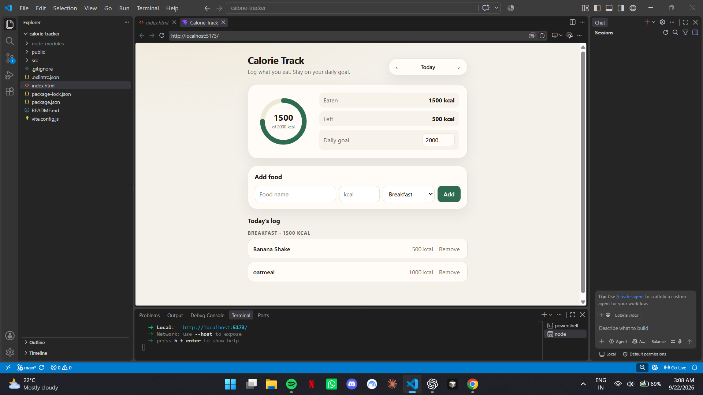

# Calorie Track

A browser-based daily calorie tracker built with React and Vite. It lets a user log food by meal, compare the total against a daily calorie goal, and keep a separate log for each date.



## Features

- Add food entries with a name, calorie amount, and meal category
- Organise entries into Breakfast, Lunch, Dinner, and Snack
- View calories eaten, calories remaining, and a visual progress ring
- Set a daily calorie goal
- Move between dates to maintain separate daily logs
- Edit or remove saved food entries
- Receive feedback for missing or invalid form values
- Persist the daily goal and food logs in browser local storage

## Technology

- React 19
- Vite 8
- JavaScript (ES modules)
- CSS
- Browser Local Storage

## Quick Start

### Prerequisites

- [Node.js](https://nodejs.org/) (current LTS version recommended)
- npm (installed with Node.js)

### Installation

```bash
git clone <your-repository-url>
cd calorie-tracker
npm install
npm run dev
```

Vite will print a local URL, normally `http://localhost:5173/`. Open it in a browser.

## How to Use

1. Enter a food name and calorie amount.
2. Choose its meal category.
3. Select **Add** to save the entry for the displayed date.
4. Select **Edit** to change an entry, or **Remove** to delete it.
5. Update the daily-goal field when required.
6. Use the date arrows to view a different day's log.

## Documentation

- [Architecture](docs/ARCHITECTURE.md) — application structure, data flow, and key decisions
- [Data and privacy](docs/DATA_AND_PRIVACY.md) — stored data, validation, and current limitations
- [Deployment](docs/DEPLOYMENT.md) — production build and static-hosting guidance

## Project Status

This is a front-end-only learning and portfolio project. It does not use an account system, backend service, or cloud database.

## License

No license has been selected yet. Add one before inviting outside contributors or sharing the project as open source.
