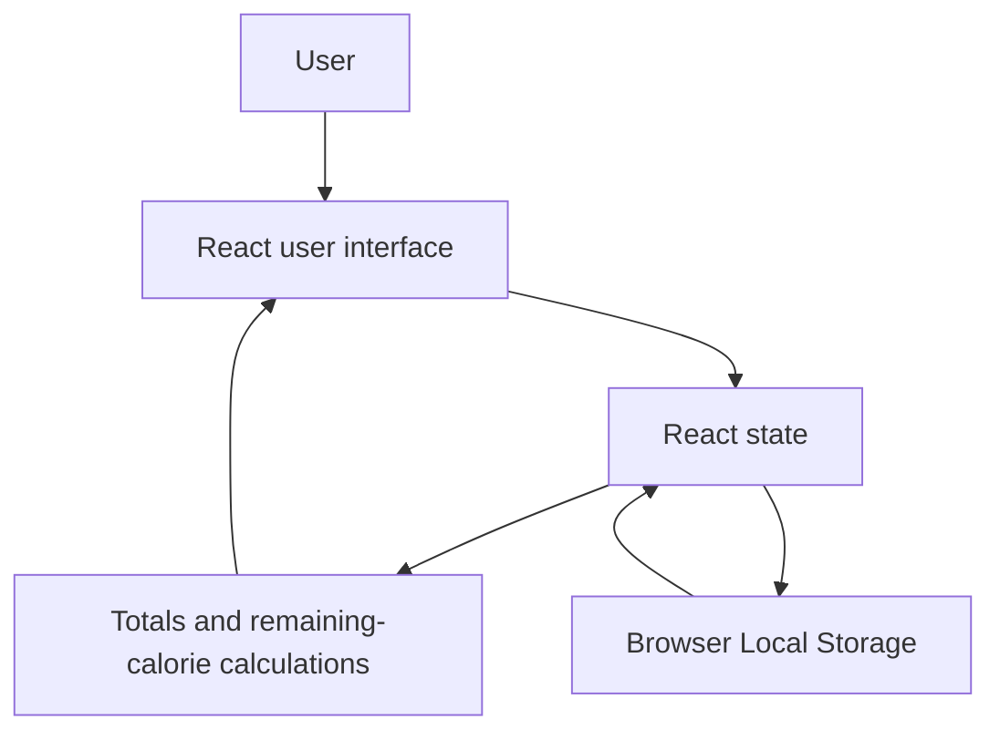

# Architecture

## Overview

Calorie Track is a single-page React application. It runs entirely in the browser and is bundled by Vite. The app has no backend API, database, authentication, or server-side code.



## Application Layers

| Layer | Location | Responsibility |
| --- | --- | --- |
| Entry point | `src/main.jsx` | Mounts the React application. |
| Application logic | `src/App.jsx` | Holds UI state, entry management, date navigation, validation, calculations, and local-storage persistence. |
| Styling | `src/App.css`, `src/index.css` | Defines the responsive layout, colour system, progress ring styling, forms, and buttons. |
| Static assets | `public/`, `src/assets/` | Contains icons and other bundled visual assets. |
| Build tooling | `vite.config.js`, `package.json` | Configures the Vite development server and production build. |

## Data Model

The application saves one JSON object under the browser local-storage key `calorie-track-v1`.

```js
{
  goal: 2000,
  days: {
    "2026-10-21": [
      {
        id: "unique-id",
        name: "Banana shake",
        calories: 500,
        meal: "Breakfast"
      }
    ]
  }
}
```

- `goal` is the user's daily calorie target.
- `days` groups entries by a local date in `YYYY-MM-DD` format.
- Each entry has a unique ID, a name, a rounded calorie value, and one of four meal categories.

## Data Flow

1. On first render, `loadState()` reads the saved goal and daily entries from local storage.
2. React state holds the selected date, current form values, food entries, and edit state.
3. When the user adds, edits, or removes an item, the `days` state is updated.
4. A React effect writes the latest `goal` and `days` data back to local storage.
5. `useMemo` derives the selected day's total calories; remaining calories are calculated from the daily goal.

## Key Behaviours

### Food management

Entries can be added, edited in place, or removed. The form requires a non-empty food name and a calorie value greater than zero. Meal options are deliberately limited to Breakfast, Lunch, Dinner, and Snack to keep the interface focused.

### Date navigation

The active date changes when the user selects the previous or next arrow. Because entries are grouped by date, each day displays its own log while sharing the same daily goal.

### Calorie progress ring

The progress ring is an inline SVG. Its stroke offset is calculated from `eaten / goal`, capped at 100%. When calories exceed the goal, the ring and remaining-calorie status use the warning colour.

## Architectural Decisions

| Decision | Why it fits this project |
| --- | --- |
| Single component (`App.jsx`) | Keeps the code approachable while the feature set is small. |
| Local Storage | Provides persistence without accounts, infrastructure, or a database. |
| No external UI library | Keeps dependencies and bundle complexity low; styles are project-owned CSS. |
| Vite | Provides a quick local development experience and simple static production build. |

## Future Evolution

If the project expands, sensible next steps would be:

- Split the UI into reusable components such as `FoodForm`, `MealLog`, `DateNavigation`, and `ProgressRing`.
- Add automated tests for calculations and form validation.
- Add a backend and authentication only if cross-device syncing is required.
- Add nutrition fields beyond calories, such as protein, carbohydrates, and fat.
